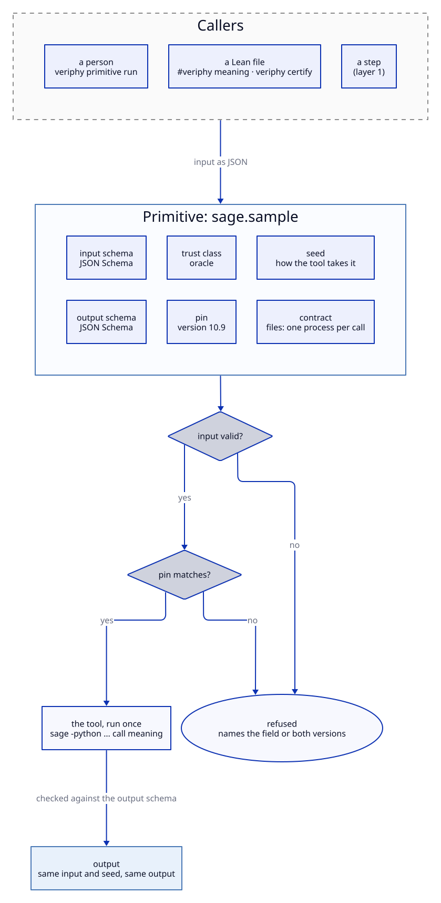
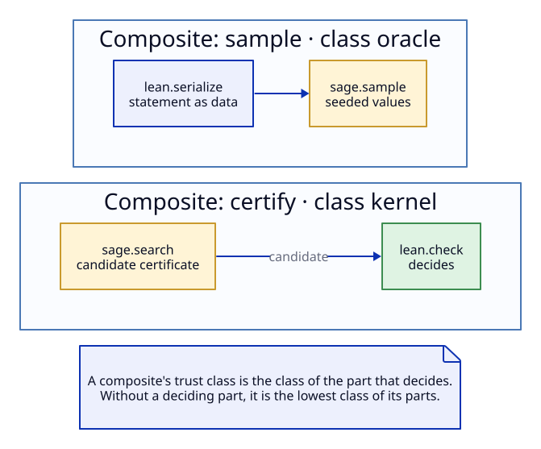
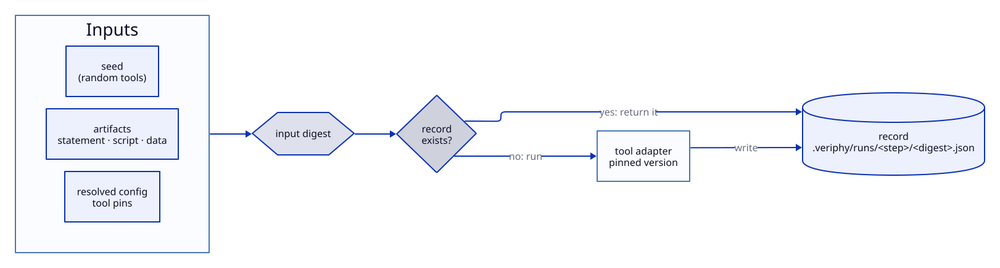

# Architecture

!!! note "Proposed"
    This page describes the target architecture. It is the reference later changes argue against, and parts of it are
    not built yet. The [last sections](#from-today-to-the-target) map today's code to it and give the order of work.

Veriphy verifies, explores and reasons about scientific claims, in any field. It is built in layers. The lowest layer
holds verification primitives: Lean checking a proof, SageMath computing a value, `oo-horn` checking a graph, R
running an analysis. Each later layer is built only from the layers below it. Nothing in the core belongs to one
field: mathematics, Lean included, is a pack, and so is reproducing a statistical analysis.

The diagrams are written in [D2](https://d2lang.com/). Their sources sit next to this page in `diagrams/`, and
`scripts/render_diagrams.sh` renders them.

## Principles

1. **Layers build on layers.** A layer uses only the layers below it, and each layer is usable on its own, by a
   person or by an agent: a primitive with no records, a step with no claim graph, a claim graph with no workflow.
2. **Primitives are deterministic and pure.** A primitive is a typed operation: the same input and seed give the same
   output. It writes no record and reads no workspace config. It runs only at its pinned version.
3. **Every recorded effect is a step.** A step is a primitive with hashed inputs and a recorded output. Running it
   again with the same inputs returns the same record.
4. **Only checkers grant trust.** Every primitive has a trust class, and a level can only be granted by a primitive of
   its own class. Searches, tests and measurements can be as heuristic as they like, because they never make anything
   true.
5. **Agents author, steps decide.** The only work that is not deterministic is the agent's: formalizing a statement,
   extracting claims, writing a script. Its output is an artifact, and every later step takes it as fixed input.
6. **Fields are packs.** A pack adds to each layer through that layer's extension point and never patches the core.
   `veriphy.yaml` selects the packs of a workspace and can override any key.
7. **One API.** Everything Veriphy runs is an operation, called the same way from Lean, the shell, Python and
   scripts, and every module belongs to one layer.

## Operations

An **operation** is a verb, the target it acts on, typed inputs, and a result:

```
operation = verb + target + inputs  →  result {status, outputs, level?, record?}
```

How an operation is built and wrapped differs by layer, and how it is called does not:

| | Built from | Adds |
|---|---|---|
| primitive | a tool | nothing: pure |
| script | a file in the workspace (Sage, R, Python) | nothing: a primitive defined by the user |
| composite | other operations | the part that decides |
| step | a primitive, script or composite | a digest and a record |
| workflow | steps | a sequence |

The same operation on the same goal, from each surface:

```lean
theorem t (a b : ℝ) : 2 * a * b ≤ a ^ 2 + b ^ 2 := by
  veriphy certify "sos.sage"
```

```
veriphy certify Basic.lean:12 --script sos.sage
```

```python
veriphy.run("certify", "Basic.lean:12", script="sos.sage")
```

Lean has one tactic, `veriphy <verb>`, and one command, `#veriphy <verb>`, so no name clashes with Mathlib and
`#veriphy help` lists every verb. The shell has one command, `veriphy <verb>` (also `python -m veriphy <verb>`), and
Python has `veriphy.run`.

### Verbs

| Verb | Does | Kind |
|---|---|---|
| `formalize`, `extract` | the agent writes a statement or the claims of a source | agent |
| `check` | Lean type-checks a file and reports each declaration's axioms | check |
| `meaning` | tests a statement at seeded values satisfying its hypotheses | evidence |
| `search` | a script looks for a candidate certificate | evidence |
| `certify` | `search`, then Lean checks the proof built from the candidate | check |
| `test` | checks instances of a statement by computation | evidence or check |
| `level` | the level of each declaration, from its proof term | derived |
| `translate` | a Lean expression to Sage and back | evidence |
| `export` | the Lean claims of a project, into the claim graph | derived |
| `validate`, `reason`, `report` | the graph's shapes, its reasoning with `oo-horn`'s verdict, the appendix | evidence, check, derived |
| `reproduce`, `vary` | reruns an analysis, and runs its declared variations | evidence |

A pack adds verbs. A verb is a step's name, and `veriphy help` lists the verbs of the workspace.

### Scripts

Every script, in any language, has the same header and the same entry point. It receives the goal and its inputs,
and returns `found(...)`, `refuted(...)` or `unknown(reason)`, which its verb turns into a status:

```python
"""Chain intermediate forms from Sage, each step closed by its own tactic."""
from veriphy.script import Goal, Result, found

SCRIPT = {"name": "calc_derivation", "serves": "certify", "inputs": {}}


def run(goal: Goal, inputs: dict) -> Result:
    middle = expand(goal.lhs.sage)
    return found(calc_chain(goal.lhs, [("=", middle, "ring"), ("=", goal.rhs, "ring")]))
```

An R script has the same shape: `run <- function(data, inputs) result(estimate = ..., se = ...)`. The header is the
script's input schema, so a script is a primitive with no other code. `veriphy.script` is the one library scripts
import, and each pack adds its helpers under it (`veriphy.script.algebra`, `veriphy.script.lie`,
`veriphy.script.stats`).

## Layers


| Layer | Holds | Deterministic because | Used by hand as | A pack adds |
|---|---|---|---|---|
| 4. Agents | playbooks and skills | they act only through the layers below | `/prove`, `/research` | playbooks, skills |
| 3. Workflows | step sequences with transitions, as data | the same records give the same next step | `veriphy next`, `veriphy run` | workflows |
| 2. Claims | the claim graph, levels, trust, conventions, reports | they are functions of the records | `veriphy claims` | levels, conventions |
| 1. Steps | a primitive with declared inputs and a record | inputs are hashed and outputs recorded | `veriphy <verb>` | steps, digest scopes |
| 0. Primitives | typed, pinned operations on tools | same input and seed, same output | `veriphy primitive run`, `#veriphy` | tools, primitives |

Configuration is not a layer. It is shared by all of them: the resolved config fills one registry per layer, and each
layer reads only its own registry.

## Layer 0: primitives



A **tool** is a program Veriphy starts: Lean, SageMath, `oo-horn`, R. A **primitive** is one typed operation on a
tool: `lean.check`, `lean.serialize`, `lean.level`, `sage.sample`, `sage.search`, `horn.check`, `r.run`. A tool is pinned, and a
primitive declares its schemas and its trust class:

```yaml
tools:
  sage:
    contract: json-lines
    run: [sage, -python, -m, veriphy.packs.math.daemon]
    pin: {version: "10.9"}

primitives:
  sage.sample:
    tool: sage
    method: sample
    trust: oracle
    input: schemas/sample.input.json
    output: schemas/sample.output.json
    seed: param                # the seed travels as the request's `seed`
```

A tool follows one of two contracts, so it needs no Python:

- **files**: the command reads its inputs from files and writes one JSON result to `{out}`;
- **json-lines**: a long-running process answers one JSON request per line, as the Sage daemon does today.

Inputs reach a tool as files or JSON, never interpolated into a shell command. Before a primitive runs, its input is
checked against its schema and its tool against its pin (an image digest, a commit with a hash, or an exact version).
A mismatch refuses to run and names the field or both versions. The output is checked against its schema.

The `lean` tool is a json-lines session: one process loads a file's imports once and then answers many requests, so
`lean.check` and `lean.serialize` do not pay for loading Mathlib on every call.

### Composites



A composite primitive is a deterministic composition of primitives, written in a pack's code. `meaning` serializes a
Lean statement and has Sage sample it, and `certify` has Sage search for a certificate and Lean check it. A composite
names the part that **decides**, and its trust class is that part's class. Without a deciding part, its class is the
lowest class of its parts. So `certify` is `kernel`, because Lean decides, and `meaning` is `oracle`.

### By hand

`veriphy primitive list` names the primitives of the workspace, `describe` prints one's schemas, and
`run <primitive> --input input.json` runs it and prints its output, with no record. A pack can also surface a
primitive where its users work: `#veriphy meaning`, `veriphy certify` and `veriphy test` call operations from a Lean
file.

## Layer 1: steps



A step is a primitive plus the inputs its digest covers. It hashes those inputs, the resolved config entry of its
primitive, and its seed into a digest. If a record with that digest exists, the step returns it without running
anything. Otherwise it calls the primitive and writes the record:

```json
{
  "step": "certify",
  "kind": "check",
  "digest": "sha256:9c1e…",
  "config": "sha256:41ab…",
  "tools": {"lean": "v4.34.1", "sage": "10.9"},
  "seed": null,
  "inputs": {"goal": "lean/MyProject/Basic.lean:12", "script": ".veriphy/certificates/sos.sage"},
  "status": "accepted",
  "outputs": {"replacement": "nlinarith [sq_nonneg (a * b - 1)]"},
  "level": "certificate"
}
```

Records live in `.veriphy/runs/<step>/<digest>.json`. Steps are declared, not programmed:

```yaml
steps:
  meaning:
    kind: evidence
    primitive: meaning
    inputs:
      file: {scope: lean-imports}
      declaration: {}
      informal: {}
    seed: true
```

A **digest scope** says what content an input stands for. `file` is the file's bytes. The `lean` pack adds
`lean-imports`: the file, every workspace file it imports, the toolchain and the manifest. Editing an unrelated file
then leaves the record valid.

Each step has one of four kinds:

| Kind | Decides | Examples |
|---|---|---|
| agent | nothing: it writes an artifact | `formalize`, `extract` |
| evidence | nothing: it finds candidates or measures | `meaning`, `search`, `test`, `reproduce`, `validate` |
| check | a trusted primitive accepts or refuses | `check`, `certify`, `reason` |
| derived | computed from other records | `level`, `report` |

## Layer 2: claims

Claims, their dependencies and their conventions form the claim graph. Levels and reports are computed from the graph
and the records, and `oo-horn` checks the graph's conclusions.


| Trust class | Means | Primitives today | Levels it grants |
|---|---|---|---|
| `kernel` | a proof checked by a proof assistant's kernel | `lean.check` | `certificate`, `lean-proof`, `kernel-test` |
| `checker` | a certificate checked by a verified checker | `horn.check` | effective levels in the claim graph |
| `reproduction` | the same result from pinned code, data and environment | `r.run` (pack) | `reproduced`, `robust` |
| `oracle` | a computation no checker confirmed | `sage.*` | `oracle-test` |
| `measurement` | a report about the artifacts, not about the claim | `shacl.validate` | none |
| `search` | candidates only | `sage.search`, any searcher | none |

The classes are fixed, so no pack can invent proof-like trust. Packs contribute levels, each naming its class and the
level directly below it, and the levels of a workspace form one order. When two packs place a level in the same
position, `config check` names both and the workspace states the order. Every report names the class beside the
level, so `reproduced` is never read as `proved`.

## Layer 3: workflows

A workflow is data: a sequence of steps and the record status that sends it elsewhere. The same records always give
the same next step.

```yaml
workflows:
  prove-claim:
    - formalize
    - meaning: {counterexample: stop}
    - check
    - search
    - certify: {rejected: search, attempts: 5}
    - test: {when: no-certificate}
    - level
    - report
```


The same model covers a field with no proofs. Reproducing an empirical claim:


1. `extract` records the claim, the dataset it uses and the assumption it rests on.
2. `reproduce` runs the authors' script on the hashed data in a pinned image, with a fixed seed. It grants
   `reproduced`, or records both estimates when they differ.
3. `vary` runs the agreed variations and grants `robust` when the estimate holds.
4. `reason` has `oo-horn` check the graph. A policy claim that rests on this one is capped at `reproduced`, and a
   paper that cites it while assuming the opposite identification assumption is reported as a clash.

## Layer 4: agents

Playbooks and skills tell an agent which workflow to follow and how to write the artifacts the agent steps need: a
formal statement, an extraction, a Sage script, an analysis script. Everything else they do goes through
`veriphy next` and `veriphy run`, so two agents on the same records take the same steps.

## Packs and configuration


A pack is a directory with a `pack.yaml`, plus its schemas, playbooks and assets, and code in its own module when it
needs any. A name in `packs` is an installed pack (the `veriphy.packs` entry point), and a path is a local directory.
A pack lists the packs it needs, and they are loaded first.

| Pack | Needs | Adds |
|---|---|---|
| `core` | | the record store, the claim graph, `oo-horn`, `shacl.validate`, the level `none`, `reason` and `report` |
| `lean` | `core` | the Lean session, `lean.check`, `lean.serialize`, `lean.level`, `check`, `level`, `lean-proof`, `lean-imports` |
| `math` | `lean` | SageMath, its script helpers, the recipes, the translation tables, `meaning`, `certify`, `test`, the other three Lean levels, `prove-claim`, `verify-paper`, the `prove`, `certify` and `research` playbooks |
| `reproduction` | `core` | R, `reproduce`, `vary`, `reproduced`, `robust`, `identification`, `reproduce-analysis`, the `reproduce` playbook |

The resolved config is the core defaults, then each pack after the packs it needs, then the workspace's
`veriphy.yaml`. A later value overrides an earlier one key by key, and `null` removes an entry. With no file, a
workspace gets `packs: [math]`, which is today's behaviour. A field brings its own pack:

```yaml
version: 1
packs: [core, ./packs/econ]          # no Lean, no SageMath

tools:
  r:
    contract: files
    run: [Rscript, "{script}", --data, "{data}", --seed, "{seed}", --out, "{out}"]
    pin: {image: "rocker/r-ver:4.4.1@sha256:5f0c…"}

primitives:
  r.run:                             # refuses data whose SHA-256 differs from the input's
    tool: r
    trust: reproduction
    input: schemas/run.json
    output: schemas/estimate.json
    seed: placeholder

levels:
  reproduced: {trust: reproduction, above: none}
  robust: {trust: reproduction, above: reproduced}

steps:
  reproduce:
    kind: evidence
    primitive: r.run
    inputs: {script: {scope: file}, data: {scope: file}, sha256: {}, claimed: {}}
    seed: true
    compare: {field: estimate, against: claimed, tolerance: 1e-6}
    grants: reproduced

conventions:
  identification: [parallel-trends, no-parallel-trends]

workflows:
  reproduce-analysis: [extract, validate, reproduce, vary, reason, report]
```

`veriphy config check` refuses a config that breaks a rule:

- every tool is pinned, and every random primitive says how it takes a seed;
- every primitive's schemas load, and every step names a primitive and a digest scope that exist;
- a step grants only levels of its primitive's trust class, and the levels form one order;
- a workflow names only steps the config defines;
- two packs that do not need each other never define the same entry, and when they do, the check names both and
  the workspace file decides.

`veriphy config show` prints the resolved config with the source of each value, and its digest enters every
step record.

## Modules


Every module belongs to one layer, and a module imports only modules of lower layers and the shared `veriphy.core`.
A test enforces the rule.

```
veriphy/
  __init__.py      run, Result: the operation API, a facade over the layers
  script/          the script API: Goal, Result, found, refuted, unknown, and each pack's helpers
  core/            shared: errors, digests, canonical JSON, process runner, pack loading and the merge
  primitives/      0  tools, primitives, contracts, pins, composites        veriphy primitive …
                      graph/: the RDF engine, and the reasoner and oo-horn adapters
  steps/           1  the step runner, digest scopes, the record store     veriphy <verb>, veriphy records
  claims/          2  the claim graph, levels, trust, reasoning, reports    veriphy claims …
  workflows/       3  next, run                                             veriphy next | run
  agents/          4  the playbook loader                                   veriphy agents path
  packs/
    core/          pack.yaml declaring the built-ins  agents (research)
    lean/          primitives/lean  steps
    math/          primitives/sage  primitives/translations  script (helpers)  steps/certificates  agents
    reproduction/  primitives/r  steps  claims  workflows  agents
```

A pack has a `pack.yaml` and the same layer subpackages, only those it needs. A pack's code at layer k imports only
Veriphy's layers up to k. What every workspace needs (the claim graph, its reasoning, `oo-horn`) lives in the layer
modules, and the `core` pack only declares it. A step's code lives at the highest layer it needs, `report` in
`veriphy.claims` for instance, and registers itself, so the step runner never imports a layer above it. The Lean library in `lean/` holds the Lean side of the `lean` and `math` packs: the
`veriphy` tactic, the `#veriphy` command and the bridge to the Sage daemon.

| Module | Layer | Public surface |
|---|---|---|
| `veriphy` | facade | `run(verb, target, **inputs) → Result`, `Result` |
| `veriphy.script` | facade | `Goal`, `Result`, `found`, `refuted`, `unknown`, pack helpers |
| `veriphy.core` | shared | errors, digests, canonical JSON, packs, `veriphy config` |
| `veriphy.primitives` | 0 | descriptors, the two contracts, pin checks, composites, `veriphy primitive` |
| `veriphy.steps` | 1 | the step runner, digest scopes, records, `veriphy <verb>`, `veriphy records` |
| `veriphy.claims` | 2 | the claim graph, levels, trust classes, reasoning, reports, `veriphy claims` |
| `veriphy.workflows` | 3 | `next`, `run` |
| `veriphy.agents` | 4 | the playbooks, `veriphy agents path` |
| `veriphy.packs.<name>` | packs | `pack.yaml` and the pack's own code, by layer |

## From today to the target

| Today | In the target |
|---|---|
| `sage_run "script"`, `sage_run file "…"` | `veriphy certify "…"` |
| `sage_test …` | `veriphy test …` |
| `#veriphy_meaning`, `#veriphy_levels`, `#veriphy_graph` | `#veriphy meaning`, `#veriphy level`, `#veriphy export` |
| `#veriphy_translate`, `#veriphy_tables`, `#veriphy_coverage`, `#veriphy_check_translations` | `#veriphy translate`, `#veriphy translations`, `#veriphy coverage`, `#veriphy check-translations` |
| `python -m veriphy elaborate`, `level`, `meaning` | `veriphy check`, `veriphy level`, `veriphy meaning` |
| `python -m veriphy.graph …` | `veriphy claims …` |
| `python -m veriphy.prompts path` | `veriphy agents path` |
| Sage scripts setting `proof` from injected globals | scripts with a header and `run(goal, inputs)` |
| `veriphy.toolkit` (226 public names) | `veriphy.script` and its pack helpers |
| `veriphy.oracle`, `veriphy.sage_server` | `veriphy.packs.math.primitives.sage` |
| `veriphy.graph` | `veriphy.claims`, with the RDF engine and the reasoner and `oo-horn` adapters in `veriphy.primitives.graph` |
| `veriphy.certificates`, `veriphy.translations` | `veriphy.packs.math.steps.certificates`, `veriphy.packs.math.primitives.translations` |
| `veriphy.prompts` | `veriphy.agents`, with the playbooks in their packs |
| the record store in `veriphy.core` | `veriphy.steps` |
| Sage daemon and its JSON-lines protocol | the json-lines contract, with each daemon method a `sage.*` primitive |
| `lake env lean` per Lean step | the `lean` session tool, loading imports once |
| `oo-horn` pinned by commit and hash | the pinning rule every tool follows, in the `core` pack |
| step records with hand-written Python steps | steps declared over primitives |
| a Lean step's digest over every Lean file | the `lean-imports` digest scope |
| five fixed levels | levels contributed by the `lean`, `math` and other packs, each with a trust class |
| playbooks in prose | workflows as data, with thin skills |

The old names keep working for one minor release and warn that they are deprecated.

## Order of work

Each milestone is an OpenSpec change under `openspec/changes/`, built from the bottom layer up:

1. `step-records` (archived): records and the step runner.
2. `meaning-step`: the meaning check, the first evidence step.
3. `layered-modules`: the module tree by layer, the import rule, and the deprecated aliases of the old modules.
4. `operation-api`: operations, verbs, results, the `veriphy` tactic, command and shell command, `veriphy.run`, and
   the script contract with `veriphy.script`.
5. `primitives`: tools, primitives, the two contracts, pins, the Lean session, and Lean, SageMath and `oo-horn`
   behind them, shipped as the `core`, `lean` and `math` packs.
6. `packs-and-config`: `veriphy.yaml`, packs by name and path, the merge, the registries and `config show`/`check`.
7. `declarative-steps`: steps declared over primitives, digest scopes with `lean-imports`, and today's steps moved
   to declarations.
8. `claims-and-trust`: trust classes, levels from packs in one order, the grant rule, and the graph's vocabulary
   taken from the config.
9. `reproduction-pack`: a pack outside mathematics that fills every layer, to test the design.
10. `workflows-as-data`: workflows, `next`, `run`, and skills that follow them.

## Open questions

- **The name.** Veriphy reads as physics. If the scope is all of science, the name should be decided before
  `veriphy.yaml` and the pack names fix it.
- **The Lean session.** The `primitives` design wraps the community REPL, with one environment per import header. A
  Veriphy server on Lean's frontend could reuse environments across headers, at the cost of maintaining it.
- **Containers.** Pinning R or Stata by image needs a container runtime on the user's machine. A pack could offer a
  lockfile alternative (`renv`, `conda-lock`) with a weaker pin.
