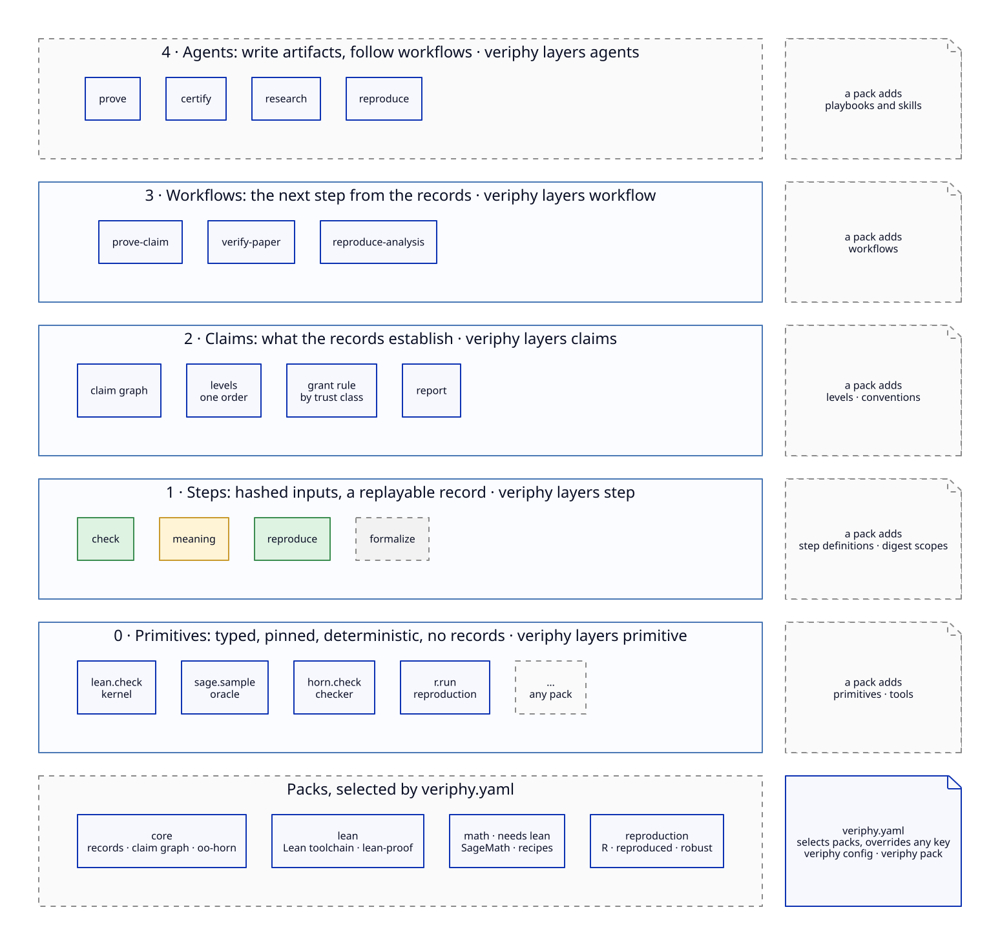
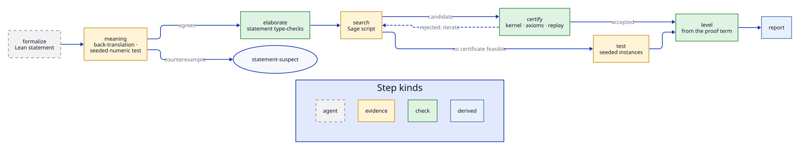

# Architecture

!!! note "Proposed"
    This page describes the target architecture. It is the reference later changes argue against, and parts of it are
    not built yet. The [last sections](#from-the-earlier-names) map the earlier names to it and give the order of work.

Veriphy verifies, explores and reasons about scientific claims, in any field. It is built in layers. The lowest layer
holds verification primitives: Lean checking a proof, SageMath computing a value, `oo-horn` checking a graph, a study's own analysis
running an analysis. Each later layer is built only from the layers below it. Nothing in the core belongs to one
field: mathematics, Lean included, is a pack, and so is reproducing a statistical analysis.

The diagrams are written in [D2](https://d2lang.com/). Their sources sit next to this page in `diagrams/`, and
`nox -s diagrams` renders them.

## Principles

1. **Layers build on layers.** A layer uses only the layers below it, and each layer is usable on its own, by a
   person or by an agent: a primitive with no records, a step with no claim graph, a claim graph with no workflow.
2. **Primitives are deterministic and pure.** A primitive is a typed operation: the same input and seed give the same
   output. It writes no record and reads no workspace config. It runs only at its pinned version.
3. **Every recorded effect is a step.** A step is a primitive with hashed inputs and a recorded output. Running it
   again with the same inputs returns the same record.
4. **Only checkers grant trust.** Every primitive has a trust class, and a level can only be granted by a primitive of
   its own class. Searches, tests and measurements can be as heuristic as they like, because they never make anything
   true.
5. **Agents author, steps decide.** The only work that is not deterministic is the agent's: formalizing a statement,
   extracting claims, writing a script. Its output is an artifact, and every later step takes it as fixed input.
6. **Fields are packs.** A pack adds to each layer through that layer's extension point and never patches the core.
   `veriphy.yaml` selects the packs of a workspace and can override any key.
7. **One API.** Everything Veriphy runs is an operation, called the same way from Lean, the shell, Python and
   scripts, and every module belongs to one layer.

## Operations

An **operation** is a verb, the target it acts on, typed inputs, and a result:

```
operation = verb + target + inputs  →  result {status, outputs, level?, record?}
```

How an operation is built and wrapped differs by layer, and how it is called does not:

| | Built from | Adds |
|---|---|---|
| primitive | a tool | nothing: pure |
| script | a file in the workspace (Sage, R, Python) | nothing: a primitive defined by the user |
| composite | other operations | the part that decides |
| step | a primitive, script or composite | a digest and a record |
| workflow | steps | a sequence |

The same operation on the same goal, from each surface:

```lean
theorem t (a b : ℝ) : 2 * a * b ≤ a ^ 2 + b ^ 2 := by
  veriphy certify "sos.sage"
```

```
veriphy certify Basic.lean:12 --script sos.sage
```

```python
veriphy.run("certify", "Basic.lean:12", script="sos.sage")
```

Lean has one tactic, `veriphy <verb>`, and one command, `#veriphy <verb>`, so no name clashes with Mathlib and
`#veriphy help` lists every verb. The shell runs a step as `veriphy layers step <verb>` (also
`python -m veriphy layers step <verb>`), and Python has `veriphy.run`. The `veriphy` command has four commands:
`layers` (one group per layer, in order: `primitive`, `step`, `claims`, `workflow`, `agents`), `config`, `pack` (the
selected packs, and a group per pack that declares programs, such as `math`) and `help`. What a pack adds appears
under them, so the top level stays the same as packs are added.

### Verbs

| Verb | Does | Kind |
|---|---|---|
| `record-statement`, `record-claims` | the agent writes a statement or the claims of a source | agent |
| `check` | Lean type-checks a file and reports each declaration's axioms | check |
| `sample` | tests a statement at seeded values satisfying its hypotheses | evidence |
| `search` | a script looks for a candidate certificate | evidence |
| `certify` | `search`, then Lean checks the proof built from the candidate | check |
| `test` | checks instances of a statement by computation | evidence or check |
| `levels` | the level of each declaration, from its proof term | derived |
| `translate` | a Lean expression to Sage and back | evidence |
| `export` | the Lean claims of a project, into the claim graph | derived |
| `validate`, `reason`, `appendix` | the graph's shapes, its reasoning with `oo-horn`'s verdict, the appendix | evidence, check, derived |
| `reproduce`, `robustness` | reruns an analysis, and runs its declared variations | check |

A pack adds verbs. A verb is a step's name, and `veriphy help` lists the verbs of the workspace.

### Scripts

Every script, in any language, has the same header and the same entry point. It receives the goal proposition and its
inputs, with the whole problem bound as `problem`, and returns `found(...)`, `refuted(...)` or `unknown(reason)`, which
its verb turns into a status:

```python
"""Chain intermediate forms from Sage, each step closed by its own tactic."""
from veriphy.script import Goal, Result, found

SCRIPT = {"name": "calc_derivation", "serves": "certify", "inputs": {}}


def run(goal: Goal, inputs: dict) -> Result:
    middle = expand(SR(str(lhs.poly)))
    chain = [("=", R(str(middle)), tactic("ring")), ("=", term(rhs.text), tactic("ring"))]
    return found(calc_chain(term(lhs.text), chain, problem))
```

An analysis script has the same shape: `run(data, inputs)` returns `{'estimate': ..., 'se': ...}`. The header is the
script's input schema, so a script is a primitive with no other code. `veriphy.script` is the one library scripts
import, and each pack adds its helpers under it (`veriphy.script.algebra`, `veriphy.script.lie`,
`veriphy.script.stats`).

## Layers



| Layer | Holds | Deterministic because | Used by hand as | A pack adds |
|---|---|---|---|---|
| 4. Agents | playbooks and skills | they act only through the layers below | `/prove`, `/research` | playbooks, skills |
| 3. Workflows | step sequences with transitions, as data | the same records give the same next step | `veriphy layers workflow next`, `veriphy layers workflow run` | workflows |
| 2. Claims | the claim graph, levels, trust, conventions, reports | they are functions of the records | `veriphy layers claims` | levels, conventions |
| 1. Steps | a primitive with declared inputs and a record | inputs are hashed and outputs recorded | `veriphy layers step <verb>` | steps, digest scopes |
| 0. Primitives | typed, pinned operations on tools | same input and seed, same output | `veriphy layers primitive run`, `#veriphy` | tools, primitives |

Configuration is not a layer. It is shared by all of them: the resolved config fills one registry per layer, and each
layer reads only its own registry.

## Layer 0: primitives


A **primitive** is one typed operation, with schemas and a trust class: `lean.check`, `lean.serialize`, `lean.levels`,
`sage.sample`, `sage.search`, `horn.check`, `shacl.validate`, `r.run`. Veriphy invents no protocol for them. A
primitive is run in one of two ways:

- **a Python function**, called in-process (`module:function`): everything Veriphy can do in its own interpreter,
  such as SHACL validation, `oo-horn`'s verdict, and Lean through `lake env lean`;
- **a files tool**: a command, run once per call, that reads its input file and writes one JSON result to `{out}`,
  such as SageMath (`sage -python -m veriphy.packs.math.primitives.sage call <method>`) or an empirical analysis.

Python keeps no process alive between calls. The one long-lived process is Lean's own: while Lean compiles a file
that runs `veriphy certify`, `#veriphy test` or `#veriphy sample`, it keeps one Sage session, a child process it
talks to in JSON-RPC 2.0 over stdin and stdout, so a file with many calls starts Sage once.

```yaml
tools:
  sage:
    contract: files            # one process per call, writing its result to {out}
    run: [sage, -python, -m, veriphy.packs.math.primitives.sage]
    pin: {version: "10.9"}

primitives:
  sage.sample:
    tool: sage
    command: [call, sample, '{input}', '{out}']
    trust: oracle
    input: {type: object, required: [problem], properties: {seed: {type: integer}}}
    output: {type: object, required: [outcome]}
    seed: param                # the seed travels as the input's `seed`
  shacl.validate:
    function: veriphy.primitives.graph._primitives:shacl_validate
    trust: measurement
    input: {type: object, required: [data, shapes]}
    output: {type: object, required: [conforms, violations]}
```

A Sage process is needed because Lean tactics call Sage, Lean cannot embed Python, and Sage takes seconds to start:
one process per session answers every request.

Inputs reach a tool as files or JSON, never interpolated into a shell command. Before a primitive runs, its input is
checked against its schema and its tool against its pin (an image digest, a commit with a hash, or an exact version).
A mismatch refuses to run and names the field or both versions. The output is checked against its schema.

Each Lean primitive runs `lake env lean` once, and pays for loading its imports every time: the simplicity is worth
more than the seconds, since a command runs one or two of them.

### Composites


A composite primitive is a deterministic composition of primitives, written in a pack's code. `sample` serializes a
Lean statement and has Sage sample it, and `certify` has Sage search for a certificate and Lean check it. A composite
names the part that **decides**, and its trust class is that part's class. Without a deciding part, its class is the
lowest class of its parts. So `certify` is `kernel`, because Lean decides, and `sample` is `oracle`.

### By hand

`veriphy layers primitive list` names the primitives of the workspace, `describe` prints one's schemas, and
`run <primitive> --input input.json` runs it and prints its output, with no record. A pack can also surface a
primitive where its users work: `#veriphy sample`, `veriphy certify` and `veriphy test` call operations from a Lean
file.

## Layer 1: steps


A step is a primitive plus the inputs its digest covers. It hashes those inputs, the resolved config entry of its
primitive, and its seed into a digest. If a record with that digest exists, the step returns it without running
anything. Otherwise it calls the primitive and writes the record:

```json
{
  "step": "certify",
  "kind": "check",
  "digest": "sha256:9c1e…",
  "config": "sha256:41ab…",
  "tools": {"lean": "v4.34.1", "sage": "10.9"},
  "seed": null,
  "inputs": {"goal": "lean/MyProject/Basic.lean:12", "script": ".veriphy/certificates/sos.sage"},
  "status": "accepted",
  "outputs": {"replacement": "nlinarith [sq_nonneg (a * b - 1)]"},
  "level": "certificate"
}
```

Records live in `.veriphy/runs/<step>/<digest>.json`. Steps are declared, not programmed:

```yaml
steps:
  sample:
    kind: evidence
    primitive: sample
    inputs:
      file: {scope: lean-imports}
      declaration: {}
      informal: {}
    seed: true
```

A **digest scope** says what content an input stands for. `file` is the file's bytes. The `math` pack adds
`lean-imports`: the file, every workspace file it imports, the toolchain and the manifest. Editing an unrelated file
then leaves the record valid.

Each step has one of four kinds:

| Kind | Decides | Examples |
|---|---|---|
| agent | nothing: it writes an artifact | `record-statement`, `record-claims` |
| evidence | nothing: it finds candidates or measures | `sample`, `search`, `test`, `reproduce`, `validate` |
| check | a trusted primitive accepts or refuses | `check`, `certify`, `reason` |
| derived | computed from other records | `levels`, `appendix` |

## Layer 2: claims

Claims, their dependencies and their conventions form the claim graph. Levels and reports are computed from the graph
and the records, and `oo-horn` checks the graph's conclusions.


| Trust class | Means | Primitives today | Levels it grants |
|---|---|---|---|
| `kernel` | a proof checked by a proof assistant's kernel | `lean.check` | `certificate`, `lean-proof`, `kernel-test` |
| `checker` | a certificate checked by a verified checker | `horn.check` | effective levels in the claim graph |
| `reproduction` | the same result from the same code and data | `analysis.run` (`statistics`), `flavio.prediction` | `recomputed`, `reproduced`, `robust`, `prediction-recomputed` |
| `oracle` | a computation no checker confirmed | `sage.*` | `oracle-test` |
| `measurement` | a report about the artifacts, not about the claim | `shacl.validate` | none |
| `search` | candidates only | `sage.search`, any searcher | none |

The classes are fixed, so no pack can invent proof-like trust. Packs contribute levels, each naming its class and the
level directly below it, and the levels of a workspace form one order. When two packs place a level in the same
position, `config check` names both and the workspace states the order. Every report names the class beside the
level, so `reproduced` is never read as `proved`.

## Layer 3: workflows

A workflow is data: a sequence of steps and the record status that sends it elsewhere. The same records always give
the same next step.

```yaml
workflows:
  prove-claim:
    - record-statement
    - sample: {counterexample: stop}
    - check: {refused: record-statement, attempts: 3}
    - record-proof
    - check: {refused: record-proof, attempts: 5}
```



The same model covers a field with no proofs. Reproducing an empirical claim:


1. `record-claims` records the claims an agent extracted: each estimate, its data and the assumption it rests on.
2. `check-concepts` checks that the constructs the claims use are concepts of a thesaurus.
3. `reproduce` runs the authors' Python script on their data, with a fixed seed. It grants `reproduced`, or records
   both estimates when they differ.
4. `robustness` runs the declared variations and grants `robust` when the estimate holds.
5. `reason` has `oo-horn` check the graph. A policy claim that rests on this one is capped at `reproduced`, and a
   paper that cites it while assuming the opposite identification assumption is reported as a clash.

## Layer 4: agents

Playbooks and skills tell an agent which workflow to follow and how to write the artifacts the agent steps need: a
formal statement, an extraction, a Sage script, an analysis script. Everything else they do goes through
`veriphy layers workflow next` and `veriphy layers workflow run`, so two agents on the same records take the same steps.

## Packs and configuration


A pack brings one field: a directory with a `pack.yaml`, plus its schemas, playbooks and assets, and code in its own
module when it needs any. A name in `packs` is a shipped pack or an installed one (the `veriphy.packs` entry point), and
a path is a local directory. A pack lists the packs it builds on, and they are loaded first.

Veriphy's own entries (the record store, the claim graph, `oo-horn`, `shacl.validate`, the level `none`, the agent
steps, `validate`, `reason` and `appendix`) are declared by a framework pack that every workspace has and none chooses.

| Pack | Field | Adds |
|---|---|---|
| `math` | mathematics in Lean | Lean (`lean.check`, `lean.serialize`, `lean.levels`, the `lean-imports` scope), SageMath, its script helpers, the recipes, the translation tables, `check`, `levels`, `sample`, `certify`, `record-proof`, the four levels from `oracle-test` to `certificate`, `prove-claim`, `verify-paper`, the `prove`, `certify` and `research` skills |
| `statistics` | analyses of data | the authors' Python analysis as a tool, `reproduce`, `robustness`, `check-p-value`, `check-mean` (SciPy), `recomputed` < `reproduced` < `robust`, `reproduce-analysis`, the `reproduce` skill |
| `social-science` | surveys and studies | `check-reliability` (pingouin), the `sampling` convention, `check-study`; requires `statistics` |
| `economics` | economic tables | `recompute` (pandas), the `price-basis` and `seasonal-adjustment` conventions; requires `statistics` |
| `physics` | formulas and constants | `check-units` (pint), `check-constant` (SciPy's CODATA), `dimensionally-consistent` |
| `life-sciences` | sequences and terms | `check-sequence` (Biopython), OBO ontologies for `check-concepts` (pronto), `sequence-checked` |
| `chemistry` | molecules and reactions | `check-molecule`, `check-reaction` (RDKit), `structure-checked` |
| `particle-physics`, `general-relativity` | subfields of physics | flavio, wilson and the PDG tables; EinsteinPy: `prediction-recomputed`, `curvature-checked` |
| `genomics` | a subfield of the life sciences | pysam: `check-variant`, `check-coverage`, `genomic-data-checked` |
| `econometrics`, `epidemiology` | subfields of economics and statistics | linearmodels; lifelines: `check-regression`, `check-hazard-ratio`, `check-median-survival` |

`check-concepts` belongs to the framework pack, so every workspace can check its concepts against a thesaurus or an
ontology.

The resolved config is the framework pack, then each chosen pack after the packs it needs, then the workspace's
`veriphy.yaml`. A later value overrides an earlier one key by key, and `null` removes an entry. With no file, a
workspace gets `packs: [math]`. A field brings its own pack; the `economics` pack recomputes a statistic with pandas:

```yaml
version: 1
name: economics
requires: [statistics]

primitives:
  table.statistic:
    function: veriphy.packs.economics.primitives._tables:statistic
    trust: reproduction
    input: {type: object, required: [data, column, statistic]}
    output: {type: object, required: [status]}

steps:
  recompute:
    kind: check
    primitive: table.statistic
    grants: recomputed
    compare: {field: value, against: claimed, tolerance: reported}
    inputs:
      data: {scope: file, path: true}
      column: {}
      claimed: {type: number, optional: true, record: true}

workflows:
  check-table: [record-claims, recompute]
```

`veriphy config check` refuses a config that breaks a rule:

- every tool is pinned, and every random primitive says how it takes a seed;
- every primitive's schemas load, and every step names a primitive and a digest scope that exist;
- a step grants only levels of its primitive's trust class, and the levels form one order;
- a workflow names only steps the config defines;
- two packs that do not need each other never define the same entry, and when they do, the check names both and
  the workspace file decides.

`veriphy config show` prints the resolved config with the source of each value, and its digest enters every
step record.

## Modules


Every module belongs to one layer, and a module imports only modules of lower layers and the shared `veriphy.core`.
A test enforces the rule.

```
veriphy/
  __init__.py      run, Result: the operation API, a facade over the layers
  script/          the script API: Goal, Result, found, refuted, unknown, and each pack's helpers
  core/            shared: errors, digests, canonical JSON, process runner, pack loading and the merge
  primitives/      0  tools, primitives, contracts, pins, composites        veriphy layers primitive …
                      graph/: the RDF engine, and the reasoner and oo-horn adapters
  steps/           1  the step runner, digest scopes, the record store     veriphy layers step <verb> | list | records
  claims/          2  the claim graph, levels, trust, reasoning, reports    veriphy layers claims …
  workflows/       3  next, run                                             veriphy layers workflow next | run
  agents/          4  the playbook loader                                   veriphy layers agents path
  packs/
    core/            the framework pack: pack.yaml declaring the built-ins, and claims/ registering their steps
    math/            lean/ (the Lean library and its Lake files)  primitives/lean  primitives/sage
                     primitives/translations  script  steps  agents (playbooks, recipes, skills)
    statistics/      primitives (the analysis runner, SciPy's consistency checks)  agents (playbook, skill)
    social_science/ economics/ physics/ life_sciences/ chemistry/   field packs: pack.yaml, primitives
    particle_physics/ general_relativity/ genomics/ econometrics/ epidemiology/   subfield packs
```

A pack has a `pack.yaml` and the same layer subpackages, only those it needs. A pack's code at layer k imports only
Veriphy's layers up to k. What every workspace needs (the claim graph, its reasoning, `oo-horn`) lives in the layer
modules, and the framework pack only declares it. A step's code lives at the highest layer it needs, `appendix` in
`veriphy.claims` for instance, and registers itself, so the step runner never imports a layer above it. The Lean library
in the math pack's `lean/` directory holds the Lean side of the pack: the `veriphy` tactic, the `#veriphy` command and
the bridge to the Sage session.

| Module | Layer | Public surface |
|---|---|---|
| `veriphy` | facade | `run(verb, target, **inputs) → Result`, `Result` |
| `veriphy.script` | facade | `Goal`, `Result`, `found`, `refuted`, `unknown`, pack helpers |
| `veriphy.core` | shared | errors, digests, canonical JSON, packs, `veriphy config` |
| `veriphy.primitives` | 0 | descriptors, the two contracts, pin checks, composites, `veriphy layers primitive` |
| `veriphy.steps` | 1 | the step runner, digest scopes, records, `veriphy layers step <verb>`, `list`, `records` |
| `veriphy.claims` | 2 | the claim graph, levels, trust classes, reasoning, reports, `veriphy layers claims` |
| `veriphy.workflows` | 3 | `next`, `run` |
| `veriphy.agents` | 4 | the playbooks, `veriphy layers agents path` |
| `veriphy.packs.<name>` | packs | `pack.yaml` and the pack's own code, by layer |

## From the earlier names

The names before 0.8 are removed, each in favour of one name:

| Before 0.8 (removed) | Now |
|---|---|
| `sage_run "script"`, `sage_run file "…"` | `veriphy certify "…"` |
| `sage_test …` | `#veriphy test …` |
| `#veriphy_meaning`, `#veriphy_levels`, `#veriphy_graph` | `#veriphy sample`, `#veriphy levels`, `#veriphy export` |
| `#veriphy_translate`, `#veriphy_tables`, `#veriphy_coverage`, `#veriphy_check_translations` | `#veriphy translate`, `#veriphy translations`, `#veriphy coverage`, `#veriphy translations check` |
| `python -m veriphy elaborate`, `level`, `meaning` | `veriphy layers step check`, `veriphy layers step levels`, `veriphy layers step sample` |
| `python -m veriphy.graph …` | `veriphy layers claims …` |
| `python -m veriphy.prompts path` | `veriphy layers agents path` |
| Sage scripts setting `proof` from injected globals | scripts with a header and `run(goal, inputs)` |
| `veriphy.toolkit` (226 public names) | `veriphy.script` and its pack helpers |
| `veriphy.oracle`, `veriphy.sage_server` | `veriphy.packs.math.primitives.sage` |
| `veriphy.graph` | `veriphy.claims`, with the RDF engine and the reasoner and `oo-horn` adapters in `veriphy.primitives.graph` |
| `veriphy.certificates`, `veriphy.translations` | `veriphy.packs.math.steps.certificates`, `veriphy.packs.math.primitives.translations` |
| `veriphy.prompts` | `veriphy.agents`, with the playbooks in the `math` pack, research included, since it proves in Lean |
| the record store in `veriphy.core` | `veriphy.steps` |
| Sage session and its own JSON-per-line protocol | JSON-RPC 2.0, with each Sage method a `sage.*` primitive |
| `oo-horn` pinned by commit and hash | the pinning rule every tool follows, in the framework pack |
| step records with hand-written Python steps | steps declared over primitives |
| a Lean step's digest over every Lean file | the `lean-imports` digest scope |
| five fixed levels | levels contributed by the field packs, each with a trust class |
| playbooks in prose | workflows as data, with thin skills |

The old names keep working for one minor release and warn that they are deprecated.

## Order of work

Each milestone was an OpenSpec change, built from the bottom layer up and archived under
`openspec/changes/archive/`:

1. `step-records` (archived): records and the step runner.
2. `meaning-step` (archived): the meaning check, the first evidence step.
3. `layered-modules` (archived): the module tree by layer, the import rule, and the deprecated aliases.
4. `operation-api` (archived): operations, verbs, results, the `veriphy` tactic, command and shell command,
   `veriphy.run`, and the script contract.
5. `primitives` (archived): primitives as Python functions or files tools, pins and schemas, the
   Lean, SageMath and `oo-horn` behind them.
6. `packs-and-config` (archived): `veriphy.yaml`, packs by name and path, JSON Merge Patch, `config show`/`check`.
7. `click-commands` (archived): the `veriphy` command as one click group.
8. `declarative-steps` (archived): steps declared over primitives, digest scopes with `lean-imports`, agent steps.
9. `claims-and-trust` (archived): trust classes, levels from packs in one order, the grant rule, levels from records.
10. `reproduction-pack` (archived): a pack outside mathematics that fills every layer, to test the design.
11. `workflows-as-data` (archived): workflows, `next`, `run`, and skills that follow them.

## Open questions

- **The name.** Veriphy reads as physics. If the scope is all of science, the name should be decided before
  `veriphy.yaml` and the pack names fix it.
- **Lean's load time.** Each Lean primitive loads its imports. A workflow with many Lean steps on one file could
  share them through the community REPL, if the time ever matters more than the process it keeps.
- **Analysis environments.** The `social-science` pack runs an analysis in Veriphy's own Python. A study with its own
  dependencies needs its environment pinned too, by a lockfile or an image.
