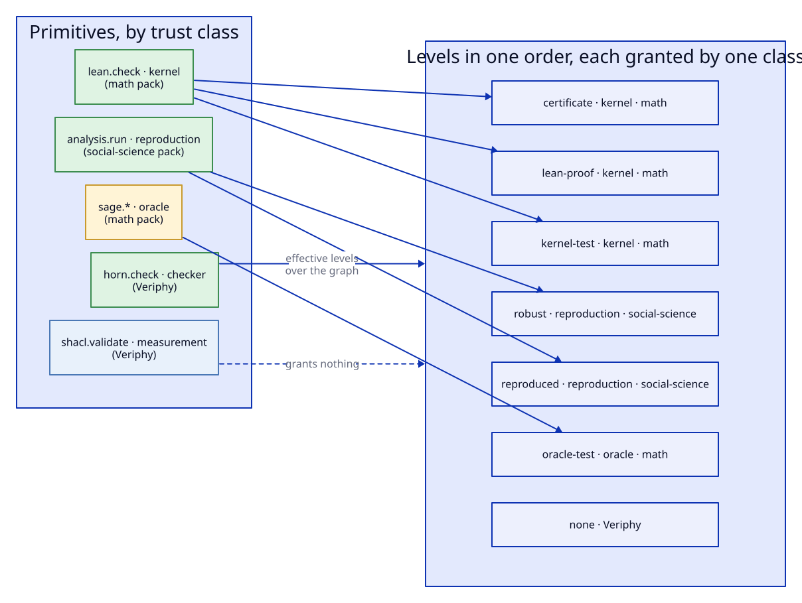
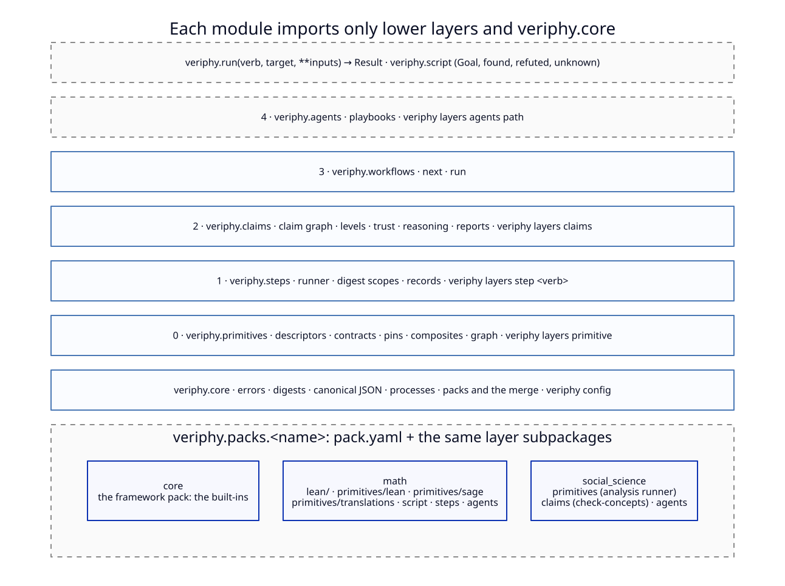

# Architecture

!!! note "Proposed"
    This page describes the target architecture. It is the reference later changes argue against, and parts of it are
    not built yet. The [last sections](#from-today-to-the-target) map today's code to it and give the order of work.

Veriphy verifies, explores and reasons about scientific claims, in any field. It is built in layers. The lowest layer
holds verification primitives: Lean checking a proof, SageMath computing a value, `oo-horn` checking a graph, R
running an analysis. Each later layer is built only from the layers below it. Nothing in the core belongs to one
field: mathematics, Lean included, is a pack, and so is reproducing a statistical analysis.

The diagrams are written in [D2](https://d2lang.com/). Their sources sit next to this page in `diagrams/`, and
`scripts/render_diagrams.sh` renders them.

## Principles

1. **Layers build on layers.** A layer uses only the layers below it, and each layer is usable on its own, by a
   person or by an agent: a primitive with no records, a step with no claim graph, a claim graph with no workflow.
2. **Primitives are deterministic and pure.** A primitive is a typed operation: the same input and seed give the same
   output. It writes no record and reads no workspace config. It runs only at its pinned version.
3. **Every recorded effect is a step.** A step is a primitive with hashed inputs and a recorded output. Running it
   again with the same inputs returns the same record.
4. **Only checkers grant trust.** Every primitive has a trust class, and a level can only be granted by a primitive of
   its own class. Searches, tests and measurements can be as heuristic as they like, because they never make anything
   true.
5. **Agents author, steps decide.** The only work that is not deterministic is the agent's: formalizing a statement,
   extracting claims, writing a script. Its output is an artifact, and every later step takes it as fixed input.
6. **Fields are packs.** A pack adds to each layer through that layer's extension point and never patches the core.
   `veriphy.yaml` selects the packs of a workspace and can override any key.

## Layers


| Layer | Holds | Deterministic because | Used by hand as | A pack adds |
|---|---|---|---|---|
| 4. Agents | playbooks and skills | they act only through the layers below | `/prove`, `/research` | playbooks, skills |
| 3. Workflows | step sequences with transitions, as data | the same records give the same next step | `python -m veriphy next`, `run` | workflows |
| 2. Claims | the claim graph, levels, trust, conventions, reports | they are functions of the records | `python -m veriphy.graph` | levels, conventions |
| 1. Steps | a primitive with declared inputs and a record | inputs are hashed and outputs recorded | `python -m veriphy <step>` | steps, digest scopes |
| 0. Primitives | typed, pinned operations on tools | same input and seed, same output | `python -m veriphy primitive run`, Lean commands | tools, primitives |

Configuration is not a layer. It is shared by all of them: the resolved config fills one registry per layer, and each
layer reads only its own registry.

## Layer 0: primitives


A **tool** is a program Veriphy starts: Lean, SageMath, `oo-horn`, R. A **primitive** is one typed operation on a
tool: `lean.check`, `lean.serialize`, `sage.sample`, `sage.search`, `oo-horn.check`, `r.run`. A tool is pinned, and a
primitive declares its schemas and its trust class:

```yaml
tools:
  sage:
    contract: json-lines
    run: [sage, -python, -m, veriphy.packs.math.daemon]
    pin: {version: "10.9"}

primitives:
  sage.sample:
    tool: sage
    method: sample
    trust: oracle
    input: schemas/sample.input.json
    output: schemas/sample.output.json
    seed: param                # the seed travels as the request's `seed`
```

A tool follows one of two contracts, so it needs no Python:

- **files**: the command reads its inputs from files and writes one JSON result to `{out}`;
- **json-lines**: a long-running process answers one JSON request per line, as the Sage daemon does today.

Inputs reach a tool as files or JSON, never interpolated into a shell command. Before a primitive runs, its input is
checked against its schema and its tool against its pin (an image digest, a commit with a hash, or an exact version).
A mismatch refuses to run and names the field or both versions. The output is checked against its schema.

The `lean` tool is a json-lines session: one process loads a file's imports once and then answers many requests, so
`lean.check` and `lean.serialize` do not pay for loading Mathlib on every call.

### Composites


A composite primitive is a deterministic composition of primitives, written in a pack's code. `meaning` serializes a
Lean statement and has Sage sample it, and `certify` has Sage search for a certificate and Lean check it. A composite
names the part that **decides**, and its trust class is that part's class. Without a deciding part, its class is the
lowest class of its parts. So `certify` is `kernel`, because Lean decides, and `meaning` is `oracle`.

### By hand

`python -m veriphy primitive list` names the primitives of the workspace, `describe` prints one's schemas, and
`run <primitive> --input input.json` runs it and prints its output, with no record. A pack can also surface a
primitive where its users work: the Lean commands `#veriphy_meaning`, `sage_run` and `sage_test` are primitives called
from a Lean file.

## Layer 1: steps


A step is a primitive plus the inputs its digest covers. It hashes those inputs, the resolved config entry of its
primitive, and its seed into a digest. If a record with that digest exists, the step returns it without running
anything. Otherwise it calls the primitive and writes the record:

```json
{
  "step": "certify",
  "kind": "check",
  "digest": "sha256:9c1e…",
  "config": "sha256:41ab…",
  "tools": {"lean": "v4.34.1", "sage": "10.9"},
  "seed": null,
  "inputs": {"goal": "lean/MyProject/Basic.lean:12", "script": ".veriphy/certificates/sos.sage"},
  "status": "accepted",
  "outputs": {"replacement": "nlinarith [sq_nonneg (a * b - 1)]"},
  "level": "certificate"
}
```

Records live in `.veriphy/runs/<step>/<digest>.json`. Steps are declared, not programmed:

```yaml
steps:
  meaning:
    kind: evidence
    primitive: meaning
    inputs:
      file: {scope: lean-imports}
      declaration: {}
      informal: {}
    seed: true
```

A **digest scope** says what content an input stands for. `file` is the file's bytes. The `lean` pack adds
`lean-imports`: the file, every workspace file it imports, the toolchain and the manifest. Editing an unrelated file
then leaves the record valid.

Each step has one of four kinds:

| Kind | Decides | Examples |
|---|---|---|
| agent | nothing: it writes an artifact | `formalize`, `extract` |
| evidence | nothing: it finds candidates or measures | `meaning`, `search`, `test`, `reproduce`, `validate` |
| check | a trusted primitive accepts or refuses | `elaborate`, `certify`, `reason` |
| derived | computed from other records | `level`, `report` |

## Layer 2: claims

Claims, their dependencies and their conventions form the claim graph. Levels and reports are computed from the graph
and the records, and `oo-horn` checks the graph's conclusions.



| Trust class | Means | Primitives today | Levels it grants |
|---|---|---|---|
| `kernel` | a proof checked by a proof assistant's kernel | `lean.check` | `certificate`, `lean-proof`, `kernel-test` |
| `checker` | a certificate checked by a verified checker | `oo-horn.check` | effective levels in the claim graph |
| `reproduction` | the same result from pinned code, data and environment | `r.run` (pack) | `reproduced`, `robust` |
| `oracle` | a computation no checker confirmed | `sage.*` | `oracle-test` |
| `measurement` | a report about the artifacts, not about the claim | `shacl.validate` | none |
| `search` | candidates only | `sage.search`, any searcher | none |

The classes are fixed, so no pack can invent proof-like trust. Packs contribute levels, each naming its class and the
level directly below it, and the levels of a workspace form one order. When two packs place a level in the same
position, `config check` names both and the workspace states the order. Every report names the class beside the
level, so `reproduced` is never read as `proved`.

## Layer 3: workflows

A workflow is data: a sequence of steps and the record status that sends it elsewhere. The same records always give
the same next step.

```yaml
workflows:
  prove-claim:
    - formalize
    - meaning: {counterexample: stop}
    - elaborate
    - search
    - certify: {rejected: search, attempts: 5}
    - test: {when: no-certificate}
    - level
    - report
```


The same model covers a field with no proofs. Reproducing an empirical claim:


1. `extract` records the claim, the dataset it uses and the assumption it rests on.
2. `reproduce` runs the authors' script on the hashed data in a pinned image, with a fixed seed. It grants
   `reproduced`, or records both estimates when they differ.
3. `robustness` runs the agreed variations and grants `robust` when the estimate holds.
4. `reason` has `oo-horn` check the graph. A policy claim that rests on this one is capped at `reproduced`, and a
   paper that cites it while assuming the opposite identification assumption is reported as a clash.

## Layer 4: agents

Playbooks and skills tell an agent which workflow to follow and how to write the artifacts the agent steps need: a
formal statement, an extraction, a Sage script, an analysis script. Everything else they do goes through
`python -m veriphy next` and `run`, so two agents on the same records take the same steps.

## Packs and configuration


A pack is a directory with a `pack.yaml`, plus its schemas, playbooks and assets, and code in its own module when it
needs any. A name in `packs` is an installed pack (the `veriphy.packs` entry point), and a path is a local directory.
A pack lists the packs it needs, and they are loaded first.

| Pack | Needs | Adds |
|---|---|---|
| `core` | | the record store, the claim graph, `oo-horn`, `shacl.validate`, the level `none`, `reason` and `report` |
| `lean` | `core` | the Lean session, `lean.check`, `lean.serialize`, `lean.levels`, `elaborate`, `level`, `lean-proof`, `lean-imports` |
| `math` | `lean` | SageMath, the toolkit, the recipes, the translation tables, `meaning`, `certify`, `test`, the other three Lean levels, `prove-claim`, `verify-paper`, the `prove`, `certify` and `research` playbooks |
| `reproduction` | `core` | R, `reproduce`, `robustness`, `reproduced`, `robust`, `identification`, `reproduce-analysis`, the `reproduce` playbook |

The resolved config is the core defaults, then each pack after the packs it needs, then the workspace's
`veriphy.yaml`. A later value overrides an earlier one key by key, and `null` removes an entry. With no file, a
workspace gets `packs: [math]`, which is today's behaviour. A field brings its own pack:

```yaml
version: 1
packs: [core, ./packs/econ]          # no Lean, no SageMath

tools:
  r:
    contract: files
    run: [Rscript, "{script}", --data, "{data}", --seed, "{seed}", --out, "{out}"]
    pin: {image: "rocker/r-ver:4.4.1@sha256:5f0c…"}

primitives:
  r.run:                             # refuses data whose SHA-256 differs from the input's
    tool: r
    trust: reproduction
    input: schemas/run.json
    output: schemas/estimate.json
    seed: placeholder

levels:
  reproduced: {trust: reproduction, above: none}
  robust: {trust: reproduction, above: reproduced}

steps:
  reproduce:
    kind: evidence
    primitive: r.run
    inputs: {script: {scope: file}, data: {scope: file}, sha256: {}, claimed: {}}
    seed: true
    compare: {field: estimate, against: claimed, tolerance: 1e-6}
    grants: reproduced

conventions:
  identification: [parallel-trends, no-parallel-trends]

workflows:
  reproduce-analysis: [extract, validate, reproduce, robustness, reason, report]
```

`python -m veriphy config check` refuses a config that breaks a rule:

- every tool is pinned, and every random primitive says how it takes a seed;
- every primitive's schemas load, and every step names a primitive and a digest scope that exist;
- a step grants only levels of its primitive's trust class, and the levels form one order;
- a workflow names only steps the config defines;
- two packs that do not need each other never define the same entry, and when they do, the check names both and
  the workspace file decides.

`python -m veriphy config show` prints the resolved config with the source of each value, and its digest enters every
step record.

## Modules



| Module | Layer | Public surface |
|---|---|---|
| `veriphy.primitives` | 0 | tool and primitive descriptors, the two contracts, pin checks, `python -m veriphy primitive` |
| `veriphy.steps` | 1 | the step runner, digest scopes, `python -m veriphy <step>` |
| `veriphy.graph` | 2 | the claim graph, levels, reasoning, reports |
| `veriphy.workflows` | 3 | `next`, `run` |
| `veriphy.config` | shared | the schema, packs, the merge, the registries, `python -m veriphy config` |
| `veriphy.core` | shared | errors, digests, canonical JSON, the record store |
| `veriphy.packs.<name>` | packs | `pack.yaml` and the pack's own code |
| Lean library | `lean` and `math` packs | `sage_run`, `sage_test`, `#veriphy_meaning`, `#veriphy_levels`, `#veriphy_graph` |

The SageMath daemon, the toolkit, the recipes and the translation tables move into `veriphy.packs.math`. Their size
is the pack's business and no longer the core API.

## From today to the target

| Today | In the target |
|---|---|
| Sage daemon and its JSON-lines protocol | the json-lines contract, with each daemon method a `sage.*` primitive |
| `lake env lean` per Lean step | the `lean` session tool, loading imports once |
| `oo-horn` pinned by commit and hash | the pinning rule every tool follows, in the `core` pack |
| step records with hand-written Python steps | steps declared over primitives |
| a Lean step's digest over every Lean file | the `lean-imports` digest scope |
| graph runs stored by digest | the record format of every step |
| five fixed levels | levels contributed by the `lean`, `math` and other packs, each with a trust class |
| Physlib translation pack | the pack mechanism, at every layer |
| `veriphy.toolkit` (226 public names) | the `math` pack's script library |
| playbooks in prose | workflows as data, with thin skills |

## Order of work

Each milestone is an OpenSpec change under `openspec/changes/`, built from the bottom layer up:

1. `step-records` (archived): records and the step runner.
2. `meaning-step` (implemented): the meaning check, the first evidence step.
3. `primitives`: tools, primitives, the two contracts, pins, the Lean session, and Lean, SageMath and `oo-horn`
   behind them, shipped as the `core`, `lean` and `math` packs.
4. `packs-and-config`: `veriphy.yaml`, packs by name and path, the merge, the registries and `config show`/`check`.
5. `declarative-steps`: steps declared over primitives, digest scopes with `lean-imports`, and today's steps moved
   to declarations.
6. `claims-and-trust`: trust classes, levels from packs in one order, the grant rule, and the graph's vocabulary
   taken from the config.
7. `reproduction-pack`: a pack outside mathematics that fills every layer, to test the design.
8. `workflows-as-data`: workflows, `next`, `run`, and skills that follow them.

## Open questions

- **The name.** Veriphy reads as physics. If the scope is all of science, the name should be decided before
  `veriphy.yaml` and the pack names fix it.
- **The Lean session.** The `primitives` design wraps the community REPL, with one environment per import header. A
  Veriphy server on Lean's frontend could reuse environments across headers, at the cost of maintaining it.
- **Containers.** Pinning R or Stata by image needs a container runtime on the user's machine. A pack could offer a
  lockfile alternative (`renv`, `conda-lock`) with a weaker pin.
