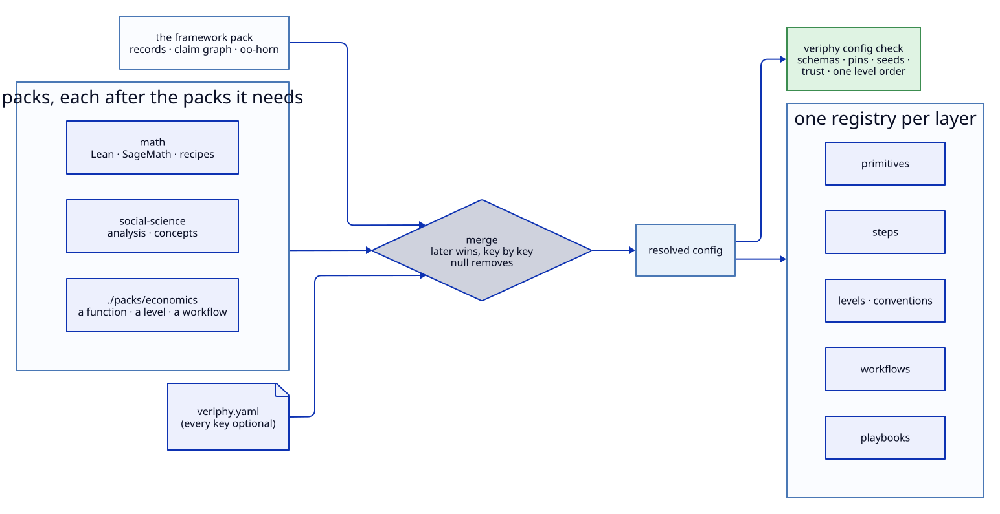
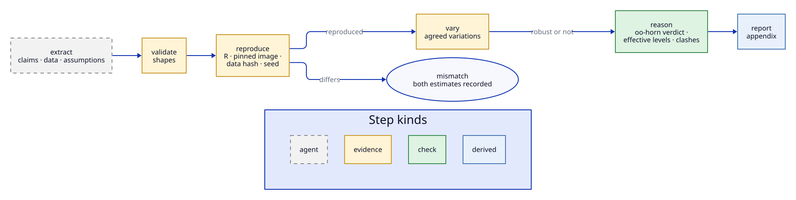

# Architecture

!!! note "Proposed"
    This page describes the target architecture. It is the reference later changes argue against, and parts of it are
    not built yet. The [last section](#from-today-to-the-target) maps today's code to it.

Veriphy verifies, explores and reasons about scientific claims, in any field. Its core makes every step deterministic,
and each field brings its own tools through configuration. Agents make the work efficient, but they only author
artifacts and choose steps, so anything an agent did can be replayed and checked.

The diagrams are written in [D2](https://d2lang.com/). Their sources sit next to this page in `diagrams/`, and
`scripts/render_diagrams.sh` renders them.

## Principles

1. **Every effect is a step.** A step has hashed inputs and a recorded output. Running it again with the same inputs
   returns the same record.
2. **Only checkers grant trust.** A tool declares a trust class, and a level can only be granted by a tool of its own
   class. Searches, tests and measurements can be as heuristic as they like, because they never make anything true.
3. **Agents author, steps decide.** The only steps that are not deterministic are the agent's: formalizing a statement
   or extracting claims. Their output is an artifact, and every later step takes it as fixed input.
4. **One file configures a workspace.** `veriphy.yaml` selects packs, adds or removes tools, and declares levels,
   steps and workflows. Every key has a default.
5. **The API follows the layers.** Each layer has one small public surface, and the module tree mirrors it.

## Layers


| Layer | Holds | Deterministic because |
|---|---|---|
| 4. Skills | agent playbooks: which workflow, which artifacts to write | they act only through steps |
| 3. Workflows | named step sequences with their decision rules, written as data | the same records give the same next step |
| 2. Steps | `formalize`, `meaning`, `search`, `check`, `test`, `reproduce`, `reason`, `report` | inputs are hashed and outputs recorded |
| 1. Tool adapters | Lean, SageMath, `oo-horn`, R, any pack's tools | each is pinned and declares its trust class |
| 0. Core | resolved config, workspace, records, claim graph, levels | pure functions of files |

## Steps and records


A step hashes its inputs (the artifacts, the resolved config and the seed) into a digest. If a record with that
digest exists, the step returns it without running anything. Otherwise it calls the tool and writes the record:

```json
{
  "step": "certify",
  "kind": "check",
  "digest": "sha256:9c1e…",
  "config": "sha256:41ab…",
  "tools": {"lean": "v4.34.1", "sage": "10.9"},
  "seed": null,
  "inputs": {"goal": "lean/MyProject/Basic.lean:12", "script": ".veriphy/certificates/sos.sage"},
  "status": "accepted",
  "outputs": {"replacement": "nlinarith [sq_nonneg (a * b - 1)]"},
  "level": "certificate"
}
```

Records live in `.veriphy/runs/<step>/<digest>.json`. A report is a function of the records, and so is every level.

Each step has one of four kinds:

| Kind | Decides | Examples |
|---|---|---|
| agent | nothing: it writes an artifact | `formalize`, `extract` |
| evidence | nothing: it finds candidates or measures | `meaning`, `search`, `test`, `reproduce`, `validate` |
| check | a trusted tool accepts or refuses | `elaborate`, `certify`, `reason` |
| derived | computed from other records | `level`, `report` |

## Trust classes and levels


| Trust class | Means | Tools today | Levels it grants |
|---|---|---|---|
| `kernel` | a proof checked by a proof assistant's kernel | Lean | `certificate`, `lean-proof`, `kernel-test` |
| `checker` | a certificate checked by a verified checker | `oo-horn` | effective levels in the claim graph |
| `reproduction` | the same result from pinned code, data and environment | R (pack) | `reproduced`, `robust` |
| `oracle` | a computation no checker confirmed | SageMath | `oracle-test` |
| `measurement` | a report about the artifacts, not about the claim | SHACL | none |
| `search` | candidates only | any searcher | none |

Levels from all fields share one order, so a claim can be capped by a claim of another field. Every report names
the trust class beside the level, so `reproduced` is never read as `proved`.

## Configuration



The resolved config is the core defaults, then each pack in the listed order, then the workspace's `veriphy.yaml`.
A later value overrides an earlier one key by key, and `null` removes an entry. With no file at all, a workspace
gets the `math` pack, which is today's behaviour:

```yaml
version: 1
packs: [math]
```

A field adds its own tools, levels, steps, conventions and workflows:

```yaml
version: 1
packs: [core, ./packs/econ]          # core is Lean, the claim graph and oo-horn, without Sage

tools:
  r:
    trust: reproduction
    run: Rscript {script} --data {data} --out {out}
    pin:
      image: rocker/r-ver:4.4.1@sha256:5f0c…
    seed: --seed {seed}
    timeout: 600

levels:
  reproduced: {trust: reproduction, above: none}
  robust: {trust: reproduction, above: reproduced}

steps:
  reproduce:
    kind: evidence
    tool: r
    inputs: [script, data]
    compare: {field: estimate, tolerance: 1e-6}
    grants: reproduced

conventions:
  identification: [parallel-trends, no-parallel-trends]

workflows:
  verify-paper: [extract, validate, reproduce, test, reason, report]
```

`veriphy config check` refuses a config that breaks a rule:

- every tool is pinned, by a container digest, a commit with a hash, or an exact version;
- a random tool declares how it takes a seed;
- a step grants only levels of its tool's trust class;
- a workflow names only steps the config defines.

`veriphy config show` prints the resolved config with the source of each value.

### Tools

A tool needs no Python. It is a command that follows one of two contracts:

- **files**: the command reads its inputs and writes a JSON result to `{out}`;
- **json-lines**: a long-running process that answers one JSON request per line, as the Sage daemon does today.

### Packs

A pack is a directory with a `pack.yaml` in the same schema as `veriphy.yaml`, plus its recipes and assets. A name
in `packs` refers to an installed Python package (`pip install veriphy-econ`) and a path to a local directory.

## Workflows

A workflow is data: a sequence of steps and the record status that sends it elsewhere. The same records always give
the same next step.

```yaml
workflows:
  prove-claim:
    - formalize
    - meaning: {counterexample: stop}
    - elaborate
    - search
    - certify: {rejected: search, attempts: 5}
    - test: {when: no-certificate}
    - level
    - report
```


The same model covers a field with no proofs. Reproducing an empirical claim:



1. `extract` records the claim, the dataset it uses and the assumption it rests on.
2. `reproduce` runs the authors' script on the hashed data in a pinned image, with a fixed seed. It grants
   `reproduced`, or records both estimates when they differ.
3. `test` runs the agreed variations and grants `robust` when the estimate holds.
4. `reason` has `oo-horn` check the graph. A policy claim that rests on this one is capped at `reproduced`, and a
   paper that cites it while assuming the opposite identification assumption is reported as a clash.

## Modules


| Module | Audience | Public surface |
|---|---|---|
| `veriphy.core` | the steps | config, records, workspace, levels |
| `veriphy.steps` | skills and users | one command per step, `python -m veriphy <step>`, and one record type |
| `veriphy.adapters` | the steps | the two tool contracts |
| `veriphy.graph` | the steps | the claim graph and its reasoning |
| packs, such as `veriphy-math` | the steps, through `pack.yaml` | tools, recipes, levels, conventions |
| Lean library | Lean files | `sage_run`, `sage_test`, `#veriphy_levels`, `#veriphy_graph` |

The Sage script library (today's `veriphy.toolkit`) moves into the `math` pack. Its size is the pack's business and
no longer the core API.

## From today to the target

| Today | In the target |
|---|---|
| Sage daemon and its JSON-lines protocol | the json-lines tool contract, with Sage as the first adapter |
| `oo-horn` pinned by commit and hash | the pinning rule every tool follows |
| graph runs stored by digest | the record format of every step |
| `sage_test` seeds and records | the pattern of evidence steps |
| Physlib translation pack | the pack mechanism |
| five fixed levels | levels contributed by packs, each with a trust class |
| `veriphy.toolkit` (226 public names) | the `math` pack's script library |
| playbooks in prose | workflows as data, with thin skills |
| numeric checks improvised by the agent | the `meaning` step, seeded and recorded |

Suggested order:

1. Records and steps in the core, with today's behaviour unchanged (`step-records`).
2. The `meaning` step, which closes the one gap with no tool today (`meaning-step`).
3. `veriphy.yaml` and its checks, with the `math` pack as the default (`workspace-config`).
4. The tool contracts, with Sage and `oo-horn` behind them (`tool-contracts`).
5. A non-mathematical pilot pack (R, for reproducing analyses) to test that the abstraction generalizes
   (`reproduction-pack`).
6. Workflows as data, and skills that follow them (`workflows-as-data`).

Each milestone is an OpenSpec change under `openspec/changes/`, with its specs, design and tasks.

## Open questions

- **The name.** Veriphy reads as physics. If the scope is all of science, the name should be decided before
  `veriphy.yaml` and the pack names fix it.
- **Lean steps from Python.** Running `elaborate`, `certify` and `level` as `python -m veriphy <step>` (through
  `lake env lean`) gives agents one interface. The cost is a Lean process per call.
- **Containers.** Pinning R or Stata by image needs a container runtime on the user's machine. A pack could offer a
  lockfile alternative (`renv`, `conda-lock`) with a weaker pin.
