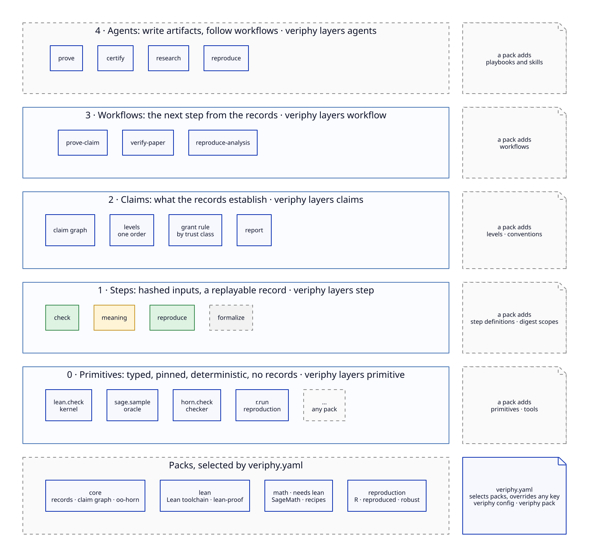

# User guide

This guide explains how Veriphy works, one idea per chapter. The examples use the study from
[getting started](getting_started.md): its files are in
[`docs/examples/social-science/`](https://github.com/georgedouzas/veriphy/tree/main/docs/examples/social-science), and
the workspace's `veriphy.yaml` selects the `social-science` pack. The test suite runs every console session on this
page.

```console
$ printf 'version: 1\npacks: [social-science]\n' > veriphy.yaml
```

## 1. Checks and records

### 1.1 Steps

A *step* is one check. You run it with `veriphy layers step <name>`, followed by its inputs:

```console
$ veriphy layers step reproduce analysis.py survey.csv --claimed 0.127 --claim trust-education
reproduce analysis.py: agrees
  found 0.126513, the claim says 0.127 (tolerance 0.0005)
  level: reproduced (reproduction)
  record: .veriphy/runs/reproduce/3ac5….json
```

The first line names the step, its first input and the result. The next lines say why, which level the check granted,
and where the record is. `veriphy layers step <name> --help` lists a step's inputs, and `veriphy layers step list`
lists the workspace's steps.

The exit status says what happened, so scripts can use it:

| Status | Meaning |
|---|---|
| 0 | the check accepted, or agreed with the claim |
| 1 | the check refused, disagreed with the claim, or found a counterexample |
| 2 | the command was used wrongly |
| 3 | the result is unchecked or undecided, for example because a tool is missing |

There are four kinds of step:

| Kind | Does | Examples |
|---|---|---|
| check | accepts or refuses, and can grant a level | `reproduce`, `robustness`, `check-units`, `check` |
| evidence | reports something, and grants no level | `check-p-value`, `check-mean`, `sample`, `validate` |
| derived | computes from other results | `appendix`, `levels` |
| agent | records a file an agent wrote, with its author | `record-claims`, `record-statement`, `record-proof` |

### 1.2 Comparing with the claim

Most steps compare what they find with the number the claim reports, given with `--claimed`. By default the tolerance
comes from the claim's own digits: half a unit in its last digit. So `--claimed 0.127` accepts anything that rounds to
0.127, and `--claimed 0.2` anything from 0.15 to 0.25:

```console
$ veriphy layers step reproduce analysis.py survey.csv --claimed 0.2
reproduce analysis.py: differs from the claim
  found 0.126513, the claim says 0.2 (tolerance 0.05)
  record: .veriphy/runs/reproduce/….json
```

A step grants its level only when the comparison agrees.

### 1.3 Records

Every step writes a *record* in `.veriphy/runs/`. It holds the inputs, the tools with their versions, the status, the
outputs and the level. `veriphy layers step records` lists them, and `veriphy layers step records <start of digest>`
prints one.

A record is named by a digest of its inputs' contents, not their paths. When you run a step on inputs it has seen,
Veriphy returns the record instead of running again:

```console
$ veriphy layers step reproduce analysis.py survey.csv --claimed 0.127 --claim trust-education
reproduce analysis.py: agrees
  found 0.126513, the claim says 0.127 (tolerance 0.0005)
  level: reproduced (reproduction)
  record: .veriphy/runs/reproduce/3ac5….json, replayed: its inputs did not change
```

- Change the data, the script or the workspace's configuration, and the step runs again.
- `--rerun` runs it anyway, and keeps both records if the result changed.
- A record whose result is `unchecked` or `failed` describes the machine, not the inputs, so the step runs again next
  time.
- `--json` prints the record instead of the summary.
- Records are not meant for git. Deleting them only means the steps run again.

## 2. Levels

### 2.1 What a level says

A *level* says how far a claim is verified. Each level belongs to a *trust class*, the kind of evidence behind it:

| Trust class | Evidence | Levels |
|---|---|---|
| `kernel` | a proof checked by Lean's kernel | `lean-proof`, `certificate`, `kernel-test` |
| `checker` | a deterministic check by an independent program | `dimensionally-consistent`, `sequence-checked`, `structure-checked`, `genomic-data-checked` |
| `reproduction` | the same result from the same code and data | `recomputed`, `reproduced`, `robust`, `prediction-recomputed` |
| `oracle` | an evaluation by a system that is not itself checked, such as Sage | `oracle-test`, `curvature-checked` |

Veriphy always prints a level with its class, as `reproduced (reproduction)`, so a reproduced number or a test never
reads as a proof.

### 2.2 The order of levels

The levels of a workspace form one order, starting at `none`. Each pack places its levels in it. With the
`social-science` pack the order is `none` < `recomputed` < `reproduced` < `robust`. With `math` it is `none` <
`oracle-test` < `kernel-test` < `lean-proof` < `certificate`.

A claim's level is the highest level its records grant. A step names the claim with `--claim`:

```console
$ veriphy layers step robustness analysis.py survey.csv --claim trust-education --variation "trust_index ~ education_years + age"
robustness analysis.py: robust under every variation
  level: robust (reproduction)
  record: .veriphy/runs/robustness/….json
```

`trust-education` is now `robust`. When two packs both put a level directly above `none`, the workspace has to say
which is higher. [Combining packs](../packs/index.md#combining-packs) shows how.

## 3. Workflows

A *workflow* is an ordered list of steps, declared by a pack. `veriphy layers workflow list` shows them:

```console
$ veriphy layers workflow list
check-study         record-claims, check-concepts, reproduce, robustness
reproduce-analysis  record-claims, reproduce, robustness
```

A workflow runs on a *target*, the first input of each of its steps, here the script. Veriphy reads the target's
records, in the order they were written, and works out the next step:

```console
$ veriphy layers workflow next reproduce-analysis analysis.py
reproduce-analysis on analysis.py: next is record-claims, an agent step: record the file holding the claims an agent extracted from a source, with their author
  write the file, then record it:
  veriphy layers step record-claims analysis.py --by <your name>
```

`veriphy layers workflow run` runs the steps that need no agent, in order, and stops at the next agent step or the
end. A step's other inputs are given as options, such as `--data survey.csv`.

A workflow entry can say what happens after a result. The `math` pack's `prove-claim` workflow:

```yaml
prove-claim:
  - record-statement
  - sample: {counterexample: stop}                 # a counterexample ends the workflow
  - check: {refused: record-statement, attempts: 3} # a refused statement goes back to be rewritten, at most 3 times
  - record-proof
  - check: {refused: record-proof, attempts: 5}
```

The same records always give the same next step. So you can stop at any point, and two agents working from the same
records take the same path.

## 4. The claim graph

### 4.1 What it is for

Steps check claims one at a time. But a paper's conclusions rest on other claims, and on choices such as how a
quantity is measured. The *claim graph* records these links. From them it works out:

- each claim's *effective level*: the lowest level among everything it rests on;
- *clashes*: claims that rest on two choices that exclude each other;
- the *impact* of a choice: every claim that rests on it.

### 4.2 Writing the claims down

The claims of a source go in `.veriphy/graph/sources/`, in Turtle, an RDF format. The file's name says who wrote it:
`chapter3.agent.ttl` for what an agent extracted, `chapter3.human.ttl` for what a person wrote or confirmed. An agent
never writes a `.human.ttl` file.

```turtle
@prefix vp: <urn:veriphy:vocabulary#> .
@prefix : <urn:veriphy:source:chapter3#> .

:trust-index a vp:Convention ; vp:conventionFor "measure-of-social-trust" ;
    vp:statement "the mean of the three trust items" .
:trust-education a vp:Claim ; vp:statedIn :chapter3 ; vp:assumes :trust-index ;
    vp:statement "Each extra year of education raises social trust by 0.127 points." .
:policy a vp:Claim ; vp:statedIn :chapter3 ; vp:uses :trust-education ;
    vp:statement "Expanding schooling would raise social trust." .
```

- `vp:Claim` is a statement the source makes, and `vp:uses` says which other claims it relies on.
- `vp:Convention` is a choice, and `vp:assumes` says which claims make it. Conventions with the same `conventionFor`
  are alternatives that exclude each other.
- `vp:formalizedBy` links a claim to the Lean theorem that states it.
- `veriphy layers claims vocabulary` prints every term.

The example's chapter goes in place like this:

```console
$ mkdir -p .veriphy/graph/sources && mv chapter3.agent.ttl .veriphy/graph/sources/
$ veriphy layers step validate
validate: conforms
  record: .veriphy/runs/validate/….json
```

`validate` checks that the extraction is complete. `veriphy layers claims confirm <source> <subject> <predicate>
<object>` moves one statement to the human file once a person has checked it.

### 4.3 Reasoning, checked

`reason` works out what follows from the claims. The reasoner itself is not trusted. Every derivation is checked by
`oo-horn`, a checker from [Open Ontologies](https://github.com/fabio-rovai/open-ontologies) that is proved correct in
Lean and shares no code with Veriphy:

```console
$ veriphy layers claims excludes --confirm
trust-index excludes trust-single-item
wrote 1 triples as human assertions
$ veriphy layers step reason
reason: entailed: oo-horn accepted the derivation
  record: .veriphy/runs/reason/….json
```

The first command confirmed that the two ways of measuring trust exclude each other. Veriphy reports a conclusion
only together with the checker's verdict:

| Verdict | Meaning |
|---|---|
| `entailed` | the checker accepted the derivation |
| `rejected` | the checker refused a line of the derivation, and names it |
| `unchecked` | no checker ran, so nothing is reported as checked |
| `incomplete` | the reasoner stopped before it derived everything |

`veriphy layers claims recheck <run>` checks a stored run again.

### 4.4 Asking the graph

```console
$ veriphy layers claims clashes
1 clash (run …: entailed):
- policy assumes trust-index and trust-single-item
$ veriphy layers claims levels --source chapter3
Run …: entailed

| claim | own | effective | capped by | Lean |
|---|---|---|---|---|
| policy | none | none |  |  |
| trust-education | robust (reproduction) | robust (reproduction) |  |  |
| trust-item | none | none |  |  |

robust: 1, reproduced: 0, recomputed: 0, none: 2
```

When a claim's effective level is below its own, the `capped by` column names the claim that holds it down.

| Command | Answers |
|---|---|
| `veriphy layers claims clashes` | which claims rest on choices that exclude each other? |
| `veriphy layers claims levels` | how far is each claim verified, and what holds it down? |
| `veriphy layers claims impact <source> <convention>` | which claims rest on this choice? |
| `veriphy layers claims slice <source> <claim>` | what does an agent need to know to work on this claim? |
| `veriphy layers claims plan --against HEAD` | what do my edits change, compared with a commit? |
| `veriphy layers step appendix <source>` | the verification appendix for the paper, in Markdown or LaTeX |

### 4.5 What the graph can't tell you

- Whether a prose claim and its Lean statement say the same thing. `formalizedBy` is an assertion, and the reports
  say who made it.
- Whether the extraction is right. A wrong extraction gives a faithfully wrong conclusion.
- That there is no clash. Finding none is the reasoner's result, not a checked conclusion.

## 5. Packs

A *pack* holds the checks of one field: its steps, the levels they grant, the conventions its claims assume, and its
workflows. A workspace names its packs in `veriphy.yaml`:

```yaml
version: 1
packs: [social-science]
```

Without a `veriphy.yaml`, a workspace uses `math`. A subfield pack, such as `econometrics`, brings its field
(`economics`) and everything that builds on (`statistics`). `veriphy pack list` shows the packs in use, and
`veriphy config show` everything they declare. `veriphy config check` checks that they fit together:

```console
$ veriphy config check
config: 3 packs, no problems
```

The [packs](../packs/index.md) pages describe each field's checks, how to combine packs, and how to write your own.

## 6. Agents

Veriphy is built so that agents can do the writing: a formal statement, a proof, the list of claims in a paper.
Veriphy checks what they write. Each pack ships *playbooks*, instructions an agent follows for the field's work:

```console
$ veriphy layers agents list --pack statistics
reproduce.md
skills/reproduce/SKILL.md
```

`veriphy layers agents show <name> --pack <pack>` prints one. In Claude Code, each skill follows a workflow. It asks
`workflow next` for the step, writes what the agent step asks for, records it, and lets `workflow run` do the rest.

| Skill | Pack | Workflow |
|---|---|---|
| `/veriphy:prove` | `math` | `prove-claim` |
| `/veriphy:certify` | `math` | one goal, inside `prove` |
| `/veriphy:research` | `math` | `verify-paper` |
| `/veriphy:reproduce` | `statistics` | `reproduce-analysis` |

## 7. Python

`veriphy.run` runs a step from Python, with the same records. The first input is positional, and the others are
keywords:

```console
$ python -c "import veriphy; r = veriphy.run('check-mean', '3.48', n=25); print(r.status, r.record.step)"
agrees check-mean
```

The [API reference](../api/index.md) documents the Python interface.

## 8. How Veriphy is built



The commands come in five layers. Each layer uses only the ones below it:

| Layer | Command group | Holds |
|---|---|---|
| 0 | `veriphy layers primitive` | single operations, such as recomputing a p-value; they record nothing |
| 1 | `veriphy layers step` | checks, each recorded |
| 2 | `veriphy layers claims` | the claim graph |
| 3 | `veriphy layers workflow` | the order of steps |
| 4 | `veriphy layers agents` | the playbooks agents follow |

A pack can add to every layer. The [architecture](../architecture/index.md) page explains the design.

## Glossary

| Term | Meaning |
|---|---|
| claim | something a source asserts: a theorem, an estimate, a quotation |
| convention | a choice a claim assumes, such as how a quantity is measured; alternatives for one thing exclude each other |
| effective level | the lowest level among everything a claim rests on |
| level | how far a claim is verified, such as `reproduced` or `lean-proof` |
| pack | the checks of one field, declared in a `pack.yaml` |
| primitive | one operation a step calls, which records nothing |
| record | what a step checked and found, kept in `.veriphy/runs/` |
| step | one recorded check |
| trust class | the kind of evidence behind a level: `kernel`, `checker`, `reproduction` or `oracle` |
| workflow | an ordered list of steps; the records decide which comes next |
| workspace | the directory Veriphy works in, marked by its `veriphy.yaml` or a Lean project |
